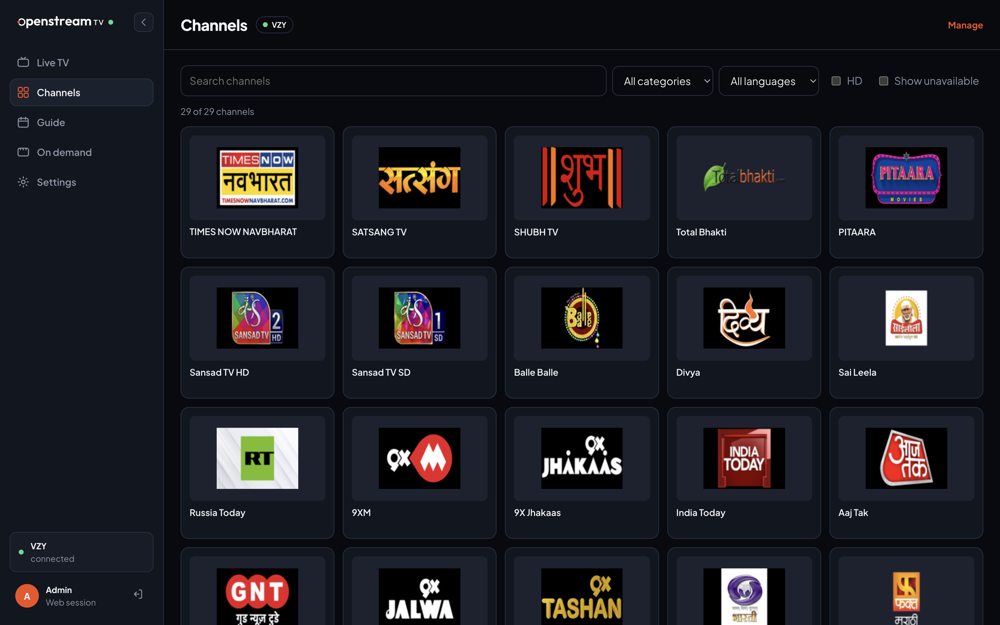
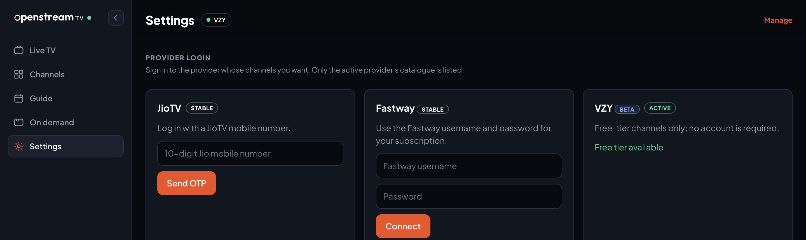

# Find Your Way Around the Web Interface

After signing in, the interface has a permanent **sidebar** on screens wider than 900px. On a phone or a narrow window the sidebar is replaced by the same five items in a **bottom tab bar**.

| Item | What it opens |
| :--- | :--- |
| **Live TV** | The home screen: a large card for the last (or first) channel, an **On now** row, category rows, and a channel rail with **Full guide** and **All channels** links. Rows show programme titles when the provider's schedule covers the current time; otherwise they fall back to the channel name or **Guide loading**. |
| **Channels** | The full channel grid with **Search channels**, **All categories**, **All languages**, **HD** and **Show unavailable** filters, plus a running `N of M channels` count. |
| **Guide** | The programme guide: one row per channel with the current programme, its time range and progress. |
| **On demand** | Movies, shows and other catalogue sections, with provider chips and search. Requires a JioTV+ connection. |
| **Settings** | Provider login, IPTV playlist and EPG links, admin password and sign out. |

The top of the window repeats the current page name, a provider pill (for example **● VZY**), and a **Manage** or **Connect a provider** link that opens Settings. The sidebar footer shows the active provider and its connection state, an **Admin / Web session** label, and the sign-out icon.

The small chevron beside the wordmark collapses the sidebar to an icon rail; the choice is remembered in that browser. Hovering a collapsed icon shows its name.

- **Channels** is the channel finder. A channel tile opens the live player, and your filters are saved in this browser.
- **Guide** shows what is on now and next without opening a player; you can filter it by language when the catalogue has more than one.
- **On demand** has sections, provider chips and search for available movies or shows. Availability depends on JioTV+ connectivity, catalogue availability and account rights. Fastway supplies live TV only.
- **Settings** shows account status, OTP sign-in controls, playlist and EPG URLs, password change, and access-key rotation.

Selecting a channel opens the live player with quality controls and the **Program guide** panel beside it. **All channels** and **Live TV** take you back. Sign out ends this browser's admin session; it does not disconnect JioTV, JioTV+, Fastway or any beta provider account. On a phone, sign out from **Settings → Security → This browser**.

Continue with [live TV](../using-live-tv/index.md), the [programme guide](../using-programme-guide/index.md), [accounts](../account-connect-jiotv/index.md), or [IPTV playlists](../using-iptv-playlists/index.md).
