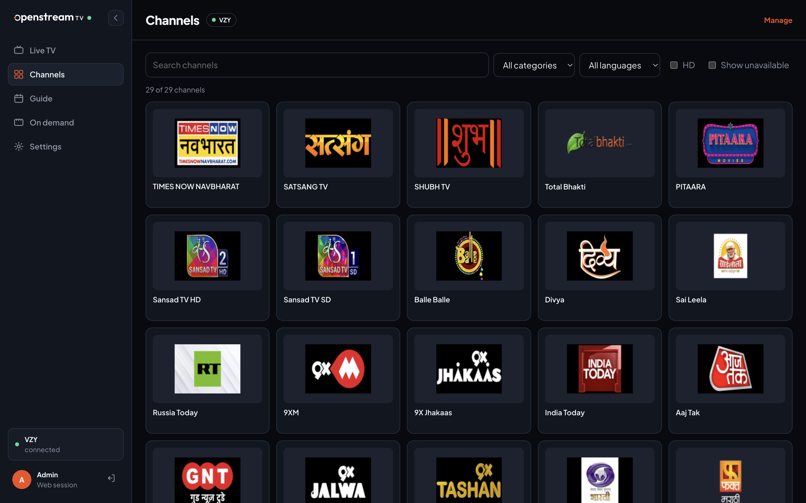
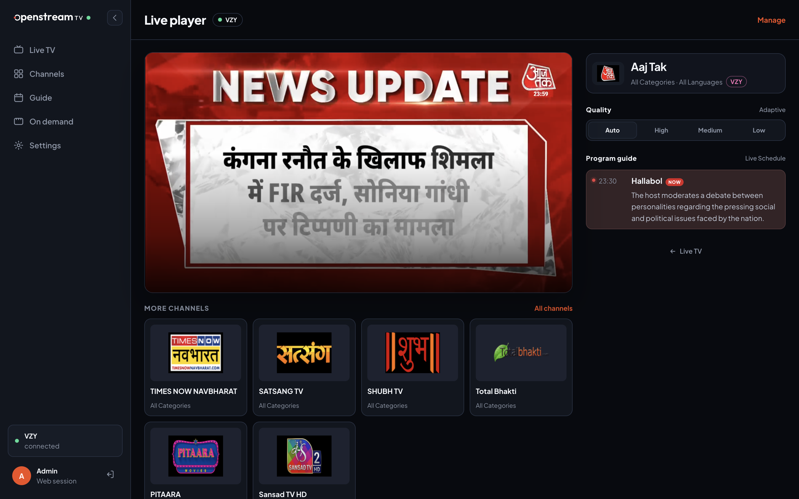

# Watch Your First Live Channel

Once your server is running and your JioTV account says **Logged in** in **Settings**, you can try live television.

1. Open **Channels** in the sidebar — or in the bottom tab bar on a phone. You should see a channel grid, a search box and filters.
2. Type the channel name in **Search channels**, or choose **All categories** or **All languages** to narrow the list.
3. Select a channel that your plan is allowed to watch. A **Subscription required** label means you may not have access.
4. Select its tile. The live player opens. Playback may need a moment to start.
5. Move the pointer over the player to show controls. Change quality, sound or full screen if those controls are offered.

**What you should see:** The screenshot shows the current v1.6.0 channel browser on a beta build using the VZY free tier. A large catalogue count or visible tile is not evidence that every channel is playable for the current account.

This player capture is a different VZY free-tier channel from the same session, and its video was playing when the screenshot was taken. Playback of one channel does not prove that every channel plays, and other providers need their own account and entitlements.

If the player says **Subscription required**, try a channel included in your plan. If the player mentions **DRM**, **Widevine**, a license, or a secure origin, see [Fix DRM playback errors](../troubleshooting-protected-playback/index.md). If the screen remains loading, see [Fix a channel that will not play](../troubleshooting-channels-and-playback/index.md).

For programme information, read [Programme guide](../using-programme-guide/index.md). The current Svelte UI does not provide catch-up browsing or playback controls even though backend catch-up routes exist. To watch on a TV with an IPTV app, use [M3U playlists](../using-iptv-playlists/index.md).
