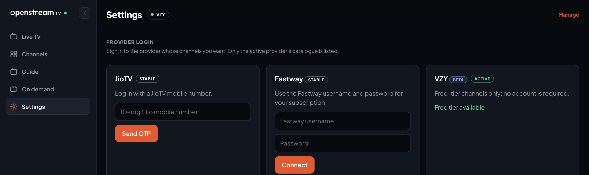

# 🧪 Install a Beta (Prerelease) Build

Beta providers ship only in **prerelease** builds. A stable release and the `latest` download never contain them, so a normal installation cannot sign in to Airtel Xstream, PlayboxTV, Tata Play or VZY and those options are absent from the installer's account list.

A prerelease has a hyphenated tag such as `v1.6.0-beta.2`. The release workflow builds those tags with the `beta` Cargo feature; stable tags are built without it.

| Build | Providers | `releases/latest` | Docker images |
| :--- | :--- | :--- | :--- |
| Stable (`v1.6.0`) | JioTV, JioTV+, Fastway | ✅ points here | ✅ published |
| Beta (`v1.6.0-beta.2`) | The three stable providers plus Airtel Xstream, PlayboxTV, Tata Play and VZY | ❌ ignored | ❌ not published |

> [!IMPORTANT]
> A beta build is for testing. Its provider integrations can change or break upstream without notice, and a prerelease does not publish a Docker image. Keep your data directory backed up before switching builds.

---

## 🔍 Step 1: Find the Current Prerelease

Open the [releases page](https://github.com/wpfyorg/openstream-tv/releases) and pick the newest release marked **Pre-release**. Its tag is the version you pass to an installer, for example `1.6.0-beta.2` (an optional leading `v` also works).

Each prerelease publishes the same asset names as a stable release (`openstream-full-*`, `openstream-slim-*`, the Windows executables, the OpenWrt packages and `SHA256SUMS`).

---

## 📥 Step 2: Install It

Every installer accepts an explicit version. Pinning is required: there is no `latest` path to a prerelease.

### Linux, macOS or Termux

```sh
curl -fsSLO https://raw.githubusercontent.com/wpfyorg/openstream-tv/main/scripts/install.sh
OPENSTREAM_VERSION=1.6.0-beta.2 sh install.sh
```

The installer verifies the download against that release's `SHA256SUMS`. Replace the version with the prerelease you found in Step 1. Add `OPENSTREAM_VARIANT=slim` if you do not want the browser interface.

### Windows

```powershell
irm https://raw.githubusercontent.com/wpfyorg/openstream-tv/main/scripts/install.ps1 -OutFile install-openstream.ps1
.\install-openstream.ps1 -Version 1.6.0-beta.2
```

`$env:OPENSTREAM_VERSION = '1.6.0-beta.2'` works as well if you pipe the script into `iex`.

### OpenWrt

```sh
OPENSTREAM_VERSION=1.6.0-beta.2 wget -qO- https://raw.githubusercontent.com/wpfyorg/openstream-tv/main/scripts/install.sh | sh
```

The installer selects the matching `openstream` or `openstream-slim` package for the router architecture from that prerelease.

### Manual release binary

Download the asset and `SHA256SUMS` from the tagged release rather than `latest`:

```sh
asset=openstream-full-x86_64-unknown-linux-musl
base=https://github.com/wpfyorg/openstream-tv/releases/download/v1.6.0-beta.2
curl -fLO "$base/$asset"
curl -fLO "$base/SHA256SUMS"
grep -F "  $asset" SHA256SUMS | sha256sum -c -
```

### Docker

Prerelease tags do **not** publish images: the Docker job runs only for stable tags. Use the stable image, or build the beta binary from source (see **Build from source** below) and run it directly.

### Build from source

```sh
git clone https://github.com/wpfyorg/openstream-tv.git
cd openstream-tv
git checkout v1.6.0-beta.2
cargo build --release --features beta
```

`target/release/ost` then has the beta routes and login commands.

---

## 🧭 Step 3: Turn the Providers On

The beta providers are compiled in but still off by default. Enable only the one you want to test, in `openstream.toml`:

```toml
playbox = true
# or: airtel = true, tataplay = true, vzy = true
```

Or set the matching environment variable for the process: `OPENSTREAM_PLAYBOX=true`, `OPENSTREAM_AIRTEL=true`, `OPENSTREAM_TATAPLAY=true` or `OPENSTREAM_VZY=true`, then restart the server. VZY needs no account; the other three use their own OTP sign-in. Settings then shows a **Beta** card for each enabled provider, and `ost --help` lists its login command.

The guided installer offers the beta providers only when the binary being installed supports them, so the same pinning command above can also connect the account during setup.



**Expected result:** the enabled provider's card appears in **Settings → Provider login** with a **Beta** pill. Sign in, or select **Use …** to make a connected provider the active catalogue. See [Airtel Xstream](../ott-provider-airtel/index.md), [PlayboxTV](../ott-provider-playbox/index.md), [Tata Play Smart](../ott-provider-tataplay/index.md) and [VZY](../ott-provider-vzy/index.md) for each provider's current limits.

---

## 🔁 Step 4: Return to Stable

Run `ost update` with no version. It resolves the newest stable release and treats `v1.6.0` as newer than `v1.6.0-beta.2`, so the beta install is replaced by the stable build; restart the server afterwards. Providers that do not exist in a stable build disappear, and a `playbox`, `airtel`, `tataplay` or `vzy` setting is ignored with a startup warning instead of failing the start.

To move to another prerelease explicitly, use its tag:

```sh
ost update --version v1.6.0-beta.2
```

For OpenWrt, re-run the installer with either the prerelease or the stable version instead of using `ost update`; the package manager owns that binary. On Docker, pull the stable tag you deployed.

---

## ✅ Step 5: Verify the Build

```sh
ost --help
```

A beta build lists `airtel login`, `playbox login`, `tataplay login` and `vzy`; a stable build does not. In the web interface, **Settings** shows **Beta** pills only for providers the running binary contains.

| Symptom | Cause | Fix |
| :--- | :--- | :--- |
| Installer offers only JioTV, JioTV+ and Fastway | It installed a stable release | Re-run the installer with `OPENSTREAM_VERSION` set to the prerelease tag |
| `airtel`, `playbox`, `tataplay` or `vzy` is ignored at startup | The stable build has no such provider | Install a prerelease build |
| No beta Docker tag | Prereleases do not publish images | Use the stable image or run the beta binary directly |
| Provider card missing after enabling it | Wrong config file or service environment, or the provider is not compiled in | Check `ost --help` and the service's `OPENSTREAM_*` values, then restart |

For the rest of the setup, continue with [Getting Started in 5 Minutes](../getting-started-in-5-minutes/index.md) or the [configuration reference](../configuration-reference/index.md).
