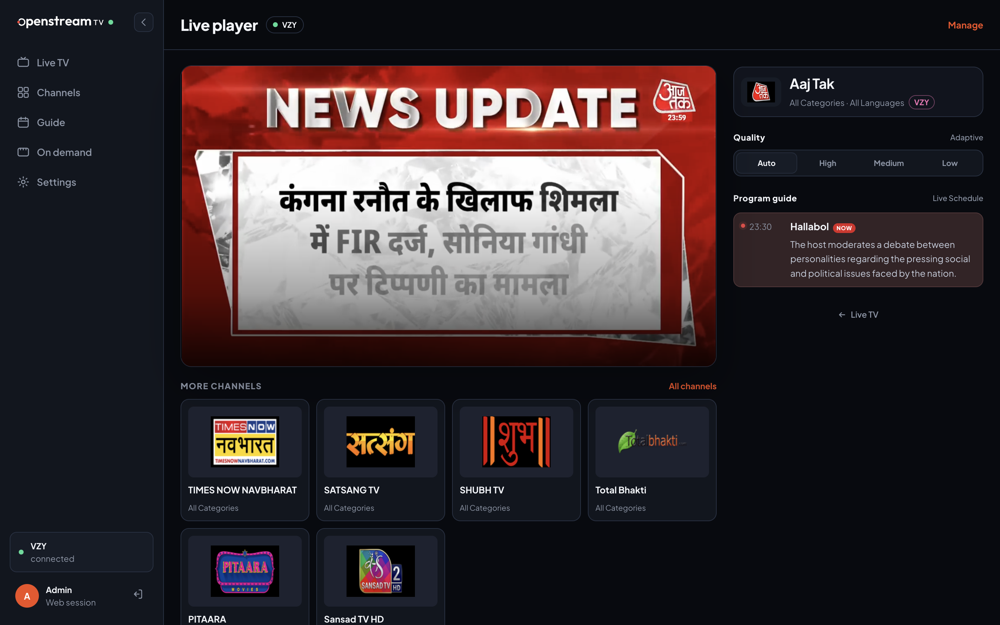

# Find and Watch Live TV

## Start on Live TV

After sign-in, **Live TV** is the home page. It has a large card for the last channel you watched (or the first playable one), with **Watch live**, an **On now** row and a few category rows. **Full guide** opens the guide, and **All channels** opens the full grid. The channel rail on the right lists other channels and links to the playlist and EPG locations in Settings.

## Find a channel

1. Select **Channels** in the sidebar (or the bottom tab bar on a phone).
2. Type part of a channel name in **Search channels**, or choose a value under **All categories** or **All languages**.
3. Turn on **HD** to show HD channels only, or **Show unavailable** to include channels the current account cannot play.
4. Select a channel tile. The list follows the provider marked **Active** in Settings.

Your filters are saved in this browser. **Expected result:** the channel opens in the live player. A dimmed tile or a **Subscription may be required** ribbon means the current account may not be able to play it.

A channel whose tile is hidden by the default availability filter can still be inspected with **Show unavailable**; if nothing in the catalogue is playable, the page says so and keeps the list visible.

## Use the player and guide

The player offers pause/resume, mute, playback quality (**Auto**, **High**, **Medium**, **Low**), picture in picture when the browser supports it, **Restart stream** and fullscreen. Quality and the more-options menu are under the player; the chosen quality is remembered in this browser. The **Program guide** panel beside the video shows the current programme and the live schedule when the provider supplies one.

This v1.6.0 capture uses the VZY free tier on a beta build, and its video was playing when captured. It documents the player and guide layout; one playing channel does not establish that every channel will play for every account.

**Expected result:** playback starts and programme details appear when the channel provides guide data. Quality choices are requests; the available stream may limit the result.

On a phone, fullscreen rotates supported mobile browsers to landscape. The player controls fade after a few seconds; tap the player to bring them back. iPhone Safari uses its native video player instead, which follows the device orientation.

If the player cannot start the stream it shows **Playback unavailable** with **Try again** and **All channels** actions. Protected playback may need HTTPS, a supported browser and working Widevine support. Account rights and provider availability also affect playback. See [Requirements](../getting-started-requirements/index.md) and [Network access and HTTPS](../configuration-network-security/index.md).

## Read the full guide

**Guide** in the sidebar lists every playable channel with its current programme, start time, progress and a play control. It is the quickest way to compare channels before opening one; see [Read the Programme Guide](../using-programme-guide/index.md).

## Catch-up availability

Some channel records indicate catch-up availability, but the current Svelte web interface has no catch-up browsing or playback controls. Do not expect the programme guide to open past programmes for playback. Catch-up route support in the server does not by itself provide a supported browser workflow.

For external players, see [IPTV playlists and the programme guide](../using-iptv-playlists/index.md). For account setup, see [Connect Your JioTV Account](../account-connect-jiotv/index.md).
