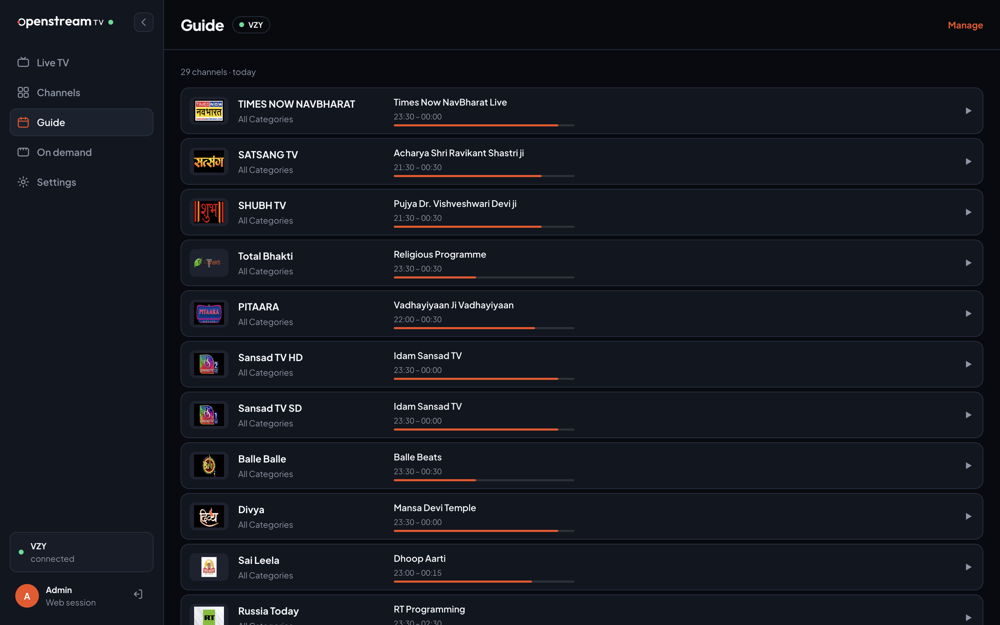

# Read the Programme Guide

OpenStream TV shows programme information for a channel when the active provider returns a schedule. There are two places to read it: the dedicated **Guide** page and the **Program guide** panel in the live player.

## Use the Guide page

1. Select **Guide** in the sidebar (or the bottom tab bar on a phone).
2. Read one row per playable channel: channel logo and name, the current programme, its start and end time, and a progress bar.
3. Where the catalogue has more than one language, use the language chips at the top to narrow the list. Leaving them all unselected shows every channel.
4. Select a row, or its play arrow, to open that channel in the live player.

Long catalogues load in pages of 24 rows as you scroll, and each visible row requests its own schedule, so the page stays responsive with a few hundred channels.

**Expected result:** each row shows tonight's programme when the provider publishes one. A channel that has no schedule still appears; its row simply has no programme text.

## Read the guide beside the player

1. Open a channel from **Live TV**, **Channels** or **Guide**.
2. Find the **Program guide** panel to the right of the video on a wide screen, or below it on a phone. It is labelled **Live schedule**.
3. The current programme is marked **NOW** and followed by the upcoming programmes in start-time order.
4. Hover or tap the video to show its controls and overlays; they hide after inactivity.

If the panel says **No guide for this channel** or **No schedule available**, the schedule request may have failed, for example on a network or server error, or the provider may have returned no usable programme data; the message does not prove which. The channel can still play. Change channel to compare, and reload before assuming the schedule is missing.

## Why a guide can be empty

- The provider publishes no schedule for that channel, or publishes it without usable start and end times. PlayboxTV and Tata Play are documented as catalogue-only for this reason.
- The account is disconnected, so no catalogue or schedule is available.
- The XMLTV file for external players is a separate setting. `epg = false` stops regeneration only when no saved `epg_enabled` override is set to true (from `ost epg on`) and `OPENSTREAM_COMPANION_APP` is not `1`; otherwise the guide keeps regenerating. With regeneration off, a cache that matches the active account is still served at `/epg.xml.gz`, and nothing expires it by age, so it can be served indefinitely and stay outdated even while the in-app guide works.

For the XMLTV file, see [Configure EPG](../configuration-iptv-epg-streaming/index.md) and [Fix Missing or Stale Programme Guide](../fix-epg-not-updating/index.md).

## Can I watch a past programme?

The current Svelte interface does **not** offer a catch-up browser or a button to play past EPG items. Some backend routes support catch-up streams, but their presence does not establish a supported end-user workflow. The on-screen guide is for current and upcoming information.

## Guide in a separate IPTV player

Enable EPG on the OpenStream TV server, then copy the **EPG** URL from **Settings → IPTV playlist & EPG** to your IPTV app. See [Set up IPTV/XMLTV](../using-iptv-playlists/index.md). For incorrect times or missing shows, see [Fix guide and playlist problems](../troubleshooting-epg-and-playlists/index.md).
