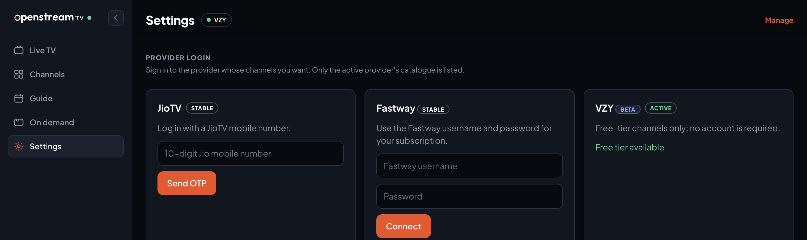

# Settings and Account Controls

Open **Settings** in the sidebar (or the bottom tab bar on a phone). The page has three groups: **Provider login**, **IPTV playlist & EPG**, and **Security**.

This v1.6.0 beta capture has VZY connected and active, with JioTV and Fastway available but disconnected. The URL fields are further down the page and are not part of this crop; your account status and private URLs will differ.

## Provider login

Each enabled provider appears as a card with a **Stable** or **Beta** pill, and the active one also shows **Active**.

- A disconnected provider shows its sign-in form: a mobile number and **Send OTP** for JioTV, JioTV+, PlayboxTV, Airtel Xstream and Tata Play, or username and password for Fastway. VZY has no account and reports **Free tier available**.
- A connected provider shows **Logged in** (JioTV) or **Connected**, a **Use …** button when another provider is active, and **Log out** or **Disconnect** unless an administrator set `disable_logout`.
- Only one provider can be active. Signing in makes that provider active; connected cards offer **Use …** to switch.

See [JioTV account sign-in](../account-connect-jiotv/index.md), [JioTV+ channels](../account-extras/index.md), [Fastway Live TV](../account-fastway/index.md), [PlayboxTV](../ott-provider-playbox/index.md), [VZY](../ott-provider-vzy/index.md), [Airtel Xstream](../ott-provider-airtel/index.md) and [Tata Play Smart](../ott-provider-tataplay/index.md). Beta cards exist only in a [beta build](../installations-beta/index.md).

## IPTV playlist & EPG

The **Playlist and guide links** card holds **Playlist** and **EPG** fields with **Copy** buttons. On a protected server these URLs contain the `/k/<key>/` access-key path. **Make a new key** invalidates old key-scoped playlist and stream links, so update every IPTV app afterwards.

The card notes that the EPG file is off when the server has not enabled it (`option epg`). When authentication is deliberately disabled, Settings shows unkeyed `/playlist.m3u` and `/epg.xml.gz` paths and key rotation is unavailable. See [IPTV playlists and XMLTV](../using-iptv-playlists/index.md).

## Security

- **This browser** ends the admin session on this device; connected providers keep their saved sign-in. This is the only sign-out control on a phone, where the sidebar is hidden.
- **Admin password** takes the current password and a new one of at least eight characters, then **Change password**.

**Expected result:** Settings confirms the password change. Other browser sessions are signed out; the current browser stays signed in. See [Admin Sessions and Sign Out](../account-sessions/index.md).

## Server options

The web page does not expose every server setting. EPG generation, provider availability, logout behavior, network binding and other runtime options are configured on the server. See [Configuration Reference](../configuration-reference/index.md), [CLI Commands](../configuration-cli/index.md), and [Network access and HTTPS](../configuration-network-security/index.md).
